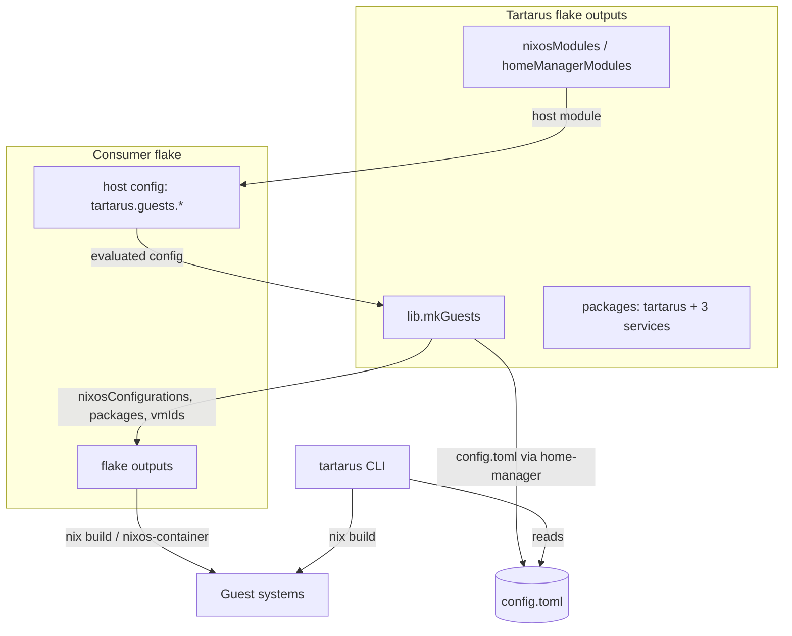

# Architecture

## Who this is for

Contributors and operators who need the component map: what each part owns, how
it is wired, and where the boundaries are.

## What you'll learn

- the layers of the repository and what each one owns,
- the flake outputs (the public surface),
- how a host config and a consumer flake feed the engine,
- the boundary between the Nix engine and the Python CLI.

## Two engines, one contract

Tartarus is split into two cooperating engines:

1. **The Nix engine** evaluates your declarations and produces guests, host
   networking, certificates, proxy config and the CLI's runtime config.
2. **The Python CLI** (`src/tartarus`) drives those artifacts at runtime: it
   builds, boots, stops and connects to guests by reading the generated
   `config.toml` — it never locates or imports the Tartarus repo.

The contract between them is `~/.config/tartarus/config.toml`, rendered by the
Nix engine at rebuild time and consumed by the CLI (see the
[data model](./data-model.md)).



## Repository layout

```
flake.nix              inputs + outputs
lib/version.nix        tartarus's own stateVersion constant
nix/lib/               shared primitives: types, names, ids, binds, shares, mkGuests
nix/guest/             the guest engine (base/network/shares/proxy/home/...)
nix/host/              host options, firewall, proxy, CA, launcher, services
nix/packages/          the CLI + the three standalone utilities
src/tartarus/          the Python package behind the CLI
tests/                 eval-level + Python test suites
docs/                  this documentation
```

### `nix/lib/` — shared primitives

| File | Owns |
| --- | --- |
| `types.nix` | Shared option types: `shareType`, `appType`, `serviceFlags`, `vmExtras`, `proxyPerGuest`, `relay`, `firewall`. |
| `ids.nix` | Stable id → IP/MAC/CID mapping, bridges, subnets, auto-assignment. |
| `names.nix` | The `vm-`/`ctn-` flake-output namespacing. |
| `binds.nix` | The bind-mount set (CA, shares) shared by the host and guest engines. |
| `shares.nix` | Share normalization (proto per platform, read-only snapshot). |
| `mkGuests.nix` | The public build contract: turns a host config into `nixosConfigurations`, `packages`, `vmIds`. |

### `nix/guest/` — the guest engine

Composed by `nix/guest/default.nix`, which imports the base, network, home and
guest firewall modules, adds the VM-only `shares`/`store-overlay` and `proxy`
modules as needed, then the user's `systemConfig` **last** so user content
always wins.

| File | Owns |
| --- | --- |
| `build.nix` | Assembles one VM/container system (`mkVm`/`mkContainer`) from a guest record. |
| `base.nix` | Base system: user, sshd, the guest halves of the host services. |
| `network.nix` | Guest-side addressing, hostnames, proxy env vars. |
| `shares.nix` / `store-overlay.nix` | VM-only shared folders and the writable `/nix/store` overlay. |
| `proxy.nix` | Guest-side proxy wiring (only when proxied or proxy-hosting). |
| `home.nix` | home-manager composition for the guest user. |
| `platform.nix` | Pure helper describing per-platform capabilities (VSOCK, proto, …). |
| `container-host.nix` | Nested-nspawn support inside a container-host VM. |

### `nix/host/` — the host engine

| File | Owns |
| --- | --- |
| `options.nix` | The `tartarus.*` option surface. |
| `instances.nix` | Derived per-guest data (effective ids, IPs, plain records) that the other modules read. |
| `config.nix` | Renders `~/.config/tartarus/config.toml` through home-manager. |
| `ca.nix` | The SSH + X.509 CA and per-guest certificates. |
| `ssh.nix` | System-wide SSH trust (`@cert-authority *.trs`). |
| `firewall.nix` | The nftables engine (host mode and guest mode). |
| `proxy.nix` | The Squid config and proxy service. |
| `relay.nix` | Host-side port relays (Darwin `socat`, Linux DNAT). |
| `launcher.nix` | The guest launcher scripts/units. |
| `autostart.nix` | The per-guest autostart user services. |
| `services.nix` | Host halves of the standalone services, wired to guests. |
| `containers.nix` | Linux native `containers.<name>` declarations. |
| `container-sudo.nix` | The scoped passwordless sudo rule for container units. |
| `linux-builder.nix` | The Darwin Linux builder (imported on Darwin only). |

`instances.nix` is the single module that forces the `tartarus.guests`
submodule; every "heavy" module reads the plain records it derives, which avoids
nixpkgs `_module.args` recursion.

### `nix/packages/` and `src/tartarus/`

| Package | Language | Purpose |
| --- | --- | --- |
| `tartarus` | Python (`src/tartarus`) | The CLI (`nix run .#tartarus`). |
| `sudo-auth-proxy` | Python + Nix modules | PAM sudo authentication proxy. |
| `ssh-agent-proxy` | Python + Nix modules | ssh-agent forwarding proxy. |
| `clipboard-bridge` | Python + Nix modules | Clipboard bridge over the graphical tunnel. |
| `tartarus-certs` | Shell (`scripts/tartarus-certs.sh`) | Standalone CA/leaf certificate tooling. |

## Boundaries

- **Consumer-owned content.** Guests are built by the consumer's flake, so the
  consumer's inputs, overlays, packages and secrets are in scope. Tartarus
  supplies the engine, not the content.
- **Nix evaluates; Python runs.** Anything that must be decided per-invocation
  (instance suffixes, ad-hoc shares, the invoking uid/home) flows through
  environment variables read by the Nix engine, which is why evaluation needs
  `--impure`.
- **The CLI never imports the repo.** It is installed from the consumer's flake
  and learns everything it needs from `config.toml`.
- **The standalone services are self-contained.** Each needs only its own
  `tartarus.<service>.*` options, `pkgs`, `lib` and `nix-service` — no host
  module, no guest, no VM.

See [How it works](./how-it-works.md) for the lifecycles and
[Interfaces](./interfaces.md) for the exact contracts.
