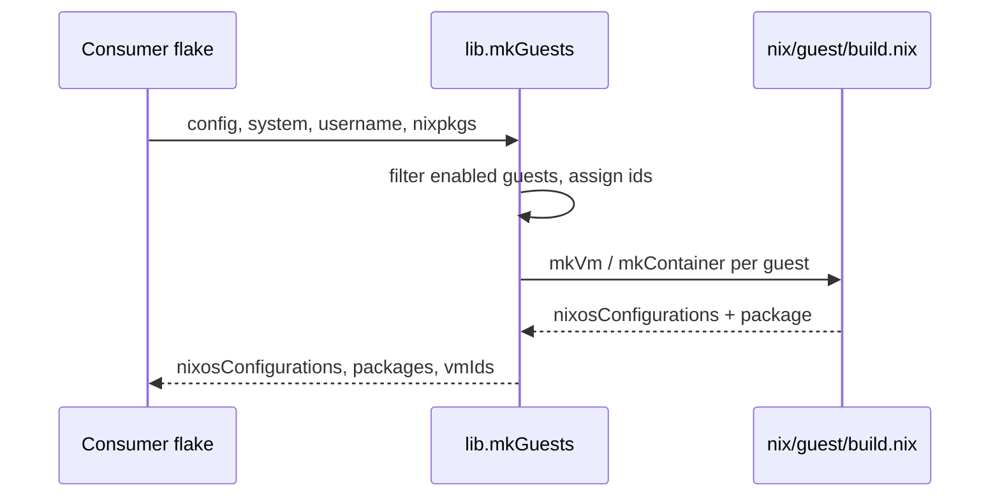

# How it works

## Who this is for

Contributors and operators who want the control flow: what happens between a
declaration and a running guest, and how the host and guest sides are wired.

## What you'll learn

- the evaluation/build lifecycle and why builds are lazy,
- what the host does at rebuild time (config, CA, firewall, proxy),
- the control flow of `tartarus start`,
- how networking differs on Linux and macOS,
- how memory is returned to the host.

## Evaluation and build lifecycle

Everything begins when the consumer's flake evaluates `lib.mkGuests` with an
already-evaluated host config:



`mkGuests`:

1. filters `config.tartarus.guests` to the `enable = true` set, per kind;
2. assigns each guest an effective id — the forced `id` verbatim, otherwise
   auto-assigned from 101 (`nix/lib/ids.nix`);
3. builds one `nixosSystem` per guest (`vm-<name>` / `ctn-<name>`) and, for VMs
   only, a runnable `microvm.declaredRunner` package;
4. returns the `vmIds` map.

**Builds are lazy.** Declaring a guest adds its flake output but realises
nothing. The guest closure is built only when you ask for it — `tartarus start`,
`nix build .#packages.<system>.vm-<name>`, or `nixos-container create` for a
container.

## The host rebuild

When you rebuild the host, the host module:

- derives the per-guest data (`instances.nix`: ids, IPs, plain records);
- issues the SSH and X.509 certificates for each enabled guest (`ca.nix`),
  namespaced by kind under `machinesDir`;
- renders the nftables rules (`firewall.nix`) and, when enabled, the Squid
  config (`proxy.nix`);
- writes `~/.config/tartarus/config.toml` through home-manager (`config.nix`);
- installs the SSH trust line and the launcher/autostart units.

The CA files and config land in the user's home; the CLI then has everything it
needs without evaluating your flake itself.

## Control flow of `tartarus start`

```mermaid
flowchart TD
  A[tartarus start NAME] --> B{NAME enabled?}
  B -- no --> X[refuse: not enabled on this host]
  B -- yes --> C{existing build valid?}
  C -- yes, no -u/--mount --> D[reuse state/result]
  C -- no --> E[nix build ... --impure]
  D --> F{kind}
  E --> F
  F -- vm --> G[launch microvm runner in background]
  F -- container --> H[sudo systemctl start container@NAME]
  G --> I[done]
  H --> I
```

Every command that names a guest runs the **enabled-guest guard** first: it
looks the name up in `config.toml` (which contains only enabled guests) and
refuses before any build, state-dir creation or SSH. This guards against acting
on a guest that has no host firewall rules, CA certificate or proxy entry.

The build cache: `start`, `restart`, `spawn` and `build` reuse an existing
`state/result` when it is valid and neither `-u/--upgrade` nor `--mount` is
given. When the flake changed since the build (git `HEAD`, dirty tracked files,
or `flake.lock`), they print one line suggesting `--upgrade`.

## Networking

### Linux

- Two static bridges: `trs0` for VMs (`10.200.0.0/24`, host `10.200.0.1`) and
  `trs1` for containers (`10.201.0.0/24`, host `10.201.0.1`).
- VSOCK is available for VMs and is the default transport for host/guest
  services; containers always use TCP.
- The host owns nftables. Proxy-only guests get their DNS (53), SSH (22) and
  plain HTTP (80) dropped; only the proxy is reachable.
- A guest-hosted proxy is reached by direct routing (a `forward` accept plus a
  masquerade exception so the client's source IP survives the per-guest `src`
  ACLs).

### macOS

- vfkit guests on `vmnet-shared` NAT (`192.168.64.0/24`, gateway
  `192.168.64.1`). No host bridge, no VSOCK, no host nftables.
- `vmenet` ports are flagged `PRIVATE`: guests reach the host but not each
  other, so anything a guest exposes is reached through a host `socat` relay
  bound to the gateway (`relays`). Guests get deterministic addresses
  (`192.168.64.<id + 42>`).
- Read-only shares are enforced host-side by copying the source into the
  read-only Nix store — see [Shares](./shares.md).

### Containers

A native container (Linux, `host = null`) is declared as a NixOS
`containers.<name>`; activation writes `/etc/nixos-containers/<name>.conf`, the
registration the CLI and `nixos-container` key off. A **nested** container
(Darwin, or an explicit `host`) runs inside a container-host VM on a VM-local
`trs2` bridge (`10.202.0.0/24`) with NAT and dnsmasq. See
[Container-host VMs](./container-host.md).

## Service transport selection

The guest/host service integrations (`services.*`) use VSOCK when the platform
provides it, TCP otherwise (Darwin, containers, or `services.disableVsock`).
Two per-guest markers, `services.sudoAuthProxyTransport` and
`services.sshAgentProxyTransport`, can instead select `unix`: an SSH-forwarded
host→guest Unix socket, with mTLS *inside* the tunnel. At most one transport per
host user is supported (the host server exposes one socket), so mixing `unix`
with a callback transport across one host's guests is an evaluation error.

## Memory management

A guest's RAM is fixed at boot (`vm.mem`, default 768 MiB); QEMU's `microvm`
machine type has no memory hotplug, so the guest's *usable* memory never
changes. What is dynamic is how much of it the **host** keeps resident. Three
mechanisms matter, and they are easy to confuse:

- **Free page reporting — automatic, on by default.** `vm.balloon.enable`
  makes QEMU advertise `free-page-reporting=on`; when the guest frees a batch of
  pages it notifies the host, which discards them and drops the VM's RSS. It
  only ever touches pages the guest has already freed, so it is always safe. It
  does nothing for a VM pinned at 100% memory.
- **The virtio-balloon — manual, host-driven.** The **host** sets the balloon
  size, never the guest. Inflating asks the guest to hand back in-use pages
  (forcing it to reclaim), which is why it can reclaim actively-used memory and
  also why over-inflating hurts. Nothing inflates it automatically; you set it
  over QMP via the runner's helper:

  ```bash
  cd ~/.local/state/tartarus/<vm>
  ./result/bin/microvm-balloon 512   # MiB; 0 deflates fully
  ```

- **deflate-on-OOM — automatic safety valve.** With
  `vm.balloon.deflateOnOOM = true`, QEMU shrinks the balloon when the guest
  nears OOM, returning memory to the guest. It has no effect until the balloon
  was inflated.

| Mechanism | Triggered by | Automatic? | Returns RAM to host |
| --- | --- | --- | --- |
| Free page reporting | the guest kernel | yes | yes (idle memory) |
| Balloon inflation | the host, via QMP | no | yes (in-use memory) |
| deflate-on-OOM | QEMU, at guest OOM | yes | no (returns pages to the guest) |

Shared memory is already active on Linux: because every VM has host shares,
microvm.nix backs guest RAM with a shared memfd. KSM is not available (the
memfd backend is shmem, not KSM-eligible), and hugepages only apply to
cloud-hypervisor, which Tartarus does not use.
