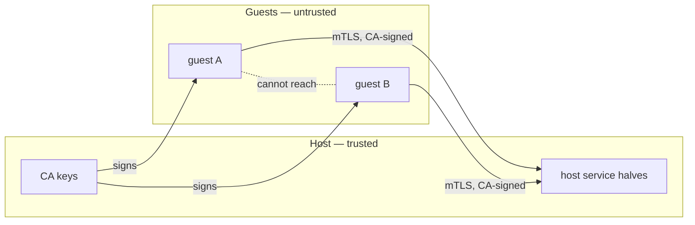

# Security model

> **Optional — not required reading.** The required docs cover everything you
> need to install, use and operate the project. Read this only if you want the
> security model and threat landscape.

## Who this is for

Security-minded readers who want the trust boundaries and the adversary model at
a glance; the per-service detail lives in the deeper docs.

## What you'll learn

- what Tartarus protects and where the trust boundaries are,
- the role of the CA and the mTLS-only stance,
- how guest isolation and egress control are enforced,
- the accepted residual risks.

## Assets

- **Host files and secrets** reachable through shares or the host/guest service
  channels (ssh-agent keys, sudo approvals, the clipboard).
- **Guest isolation** — one guest must not read or modify another, nor the host,
  beyond what is declared.
- **CA private keys** — the SSH and X.509 roots that authenticate every guest.
- **Egress** — a guest must only reach the hosts it is allowed to reach.

## Trust boundaries

The host and its CA keys are trusted. Guests are untrusted: everything a guest
can do crosses a boundary enforced by the hypervisor, the kernel, nftables or a
CA-authenticated channel.

## How the boundaries are enforced

- **SSH.** The host owns an SSH certificate authority; guest host keys are
  signed and the host trusts `@cert-authority *.trs`, so host→guest SSH
  validates without fingerprint prompts and cannot be silently MITM'd.
- **Host/guest services.** `ssh-agent-proxy`, `sudo-auth-proxy` and
  `clipboard-bridge` authenticate both ends with the X.509 CA over mTLS. The
  weaker `ssh`/`x509`/`signature` auth modes were removed: the three security
  knobs are each `"transport"` or `"none"`, and disabling authentication is
  explicit and refusable. See [ssh-agent-proxy](./ssh-agent-proxy.md) and
  [sudo-auth-proxy](./sudo-auth-proxy.md).
- **Network isolation.** On Linux the host owns nftables: each guest kind has
  its own table, exact per-guest rules, and a `policy drop` input chain; guests
  cannot reach each other unless routed. On macOS, vfkit's `vmenet` ports are
  `PRIVATE`, so guests reach the host but not each other; anything exposed goes
  through an explicit host relay.
- **Egress control.** A proxy-only guest has DNS (53), SSH (22), plain HTTP (80)
  and ICMP dropped and can reach only the proxy; the allowlist is HTTPS/443-only.
  The proxy does **not** MITM — it cannot see request bodies, only metadata.
- **Read-only shares.** A read-only share must not be guest-writable, or a guest
  could rewrite a host config file and get host code execution. Linux enforces
  it at the hypervisor; macOS enforces it host-side with a read-only store
  snapshot, and key-bearing shares opt out of snapshotting. See
  [Shares](./shares.md).
- **Overlay shares** are Linux-only: the host source is a forced read-only lower
  and the guest writes only to its own upper/work layer, so the host folder is
  never modified. On Darwin evaluation fails rather than falling back to a
  writable lower (vfkit ignores `readOnly`, and overlayfs cannot use the
  root-owned store snapshot as an upper). A native container with
  `privateUsers = "no"` runs the overlay as (container) root, so its upper/work
  layer is root-owned inside the container rootfs; that is the same trust
  boundary as the container itself, not the host.
- **Container isolation.** A native container can be given its own user
  namespace (`privateUsers`): `"identity"` gives capability isolation, and
  `"pick"`/an int gives real UID isolation (with `idmap` on Tartarus's own bind
  mounts, except shares that opt out because their source filesystem — such as
  agenix's ramfs `/run/agenix` — cannot be ID-mapped).
- **The enabled-guest guard.** The CLI refuses to act on a guest that is not
  enabled, because a disabled guest has no firewall rules, CA certificate or
  proxy entry — i.e. no host-side enforcement in place.

## Adversaries considered

- A **malicious guest workload** trying to escape to the host, read host files,
  reach other guests, or pivot to the internet.
- A **malicious co-tenant guest** on the same host.
- A **network attacker** trying to impersonate a guest or the host service
  endpoint (defeated by CA-pinned mTLS and signed host keys).
- A **misconfiguration** that would silently disable a protection (defeated by
  fail-closed defaults and evaluation assertions).

## Trust assumptions

- The host kernel, hypervisor (QEMU/KVM or vfkit) and systemd-nspawn are sound.
- The CA private keys and the user's home remain confidential.
- The consumer's `systemConfig`/`userConfig` does not weaken the host
  (Tartarus provides the boundary; content is the consumer's responsibility).
- For `privateUsers = "pick"`, the bind-mount source filesystems support
  ID-mapped mounts, or the share sets `idmap = false` (the files then appear
  owned by `nobody`/`nogroup` inside the container, so they must be readable
  through their mode bits — e.g. the `0444` agenix secrets).

## Residual risks (accepted)

- A guest with root can remount its own guest-side mounts, so guest-side
  `readOnly` is not a boundary — only the host-side enforcement is.
- The store snapshot for macOS read-only shares is world-readable; secret-bearing
  shares must set `snapshot = false`.
- Nested-nspawn on macOS shares the container-host VM's kernel: containers are
  isolated from each other by nspawn, not by separate kernels.
- No anti-fatigue or rate-limiting on the sudo confirmation dialog; a guest can
  spam approval prompts. See [sudo-auth-proxy](./sudo-auth-proxy.md) §11.3.
- The host/guest service channels rely on the guest system being built from the
  declared `systemConfig`; a consumer that disables the guest-side pieces loses
  the corresponding protections.

For the detailed threat tables, see the [ssh-agent-proxy](./ssh-agent-proxy.md)
and [sudo-auth-proxy](./sudo-auth-proxy.md) threat models.
