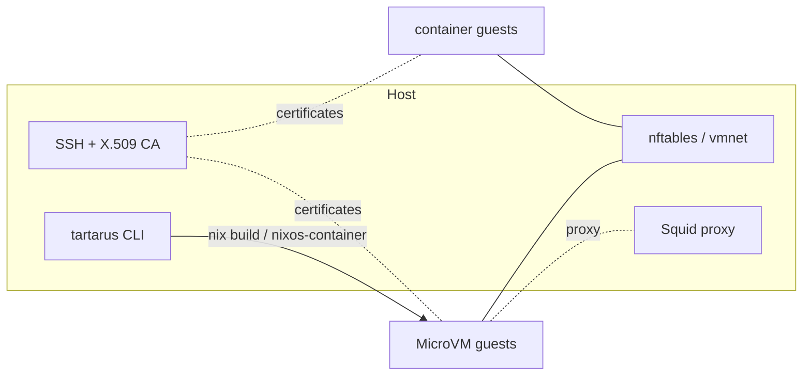

# Introduction

## Who this is for

Anyone new to Tartarus who wants to understand what it does and the model it
uses before installing it.

## What you'll learn

- what Tartarus is and the problem it solves,
- the two guest kinds and why they exist,
- the pieces Tartarus wires up on the host,
- how a guest gets its content (spoiler: from *your* flake).

## What Tartarus is

Tartarus runs throwaway NixOS systems — MicroVMs and systemd-nspawn
containers — **built from your own flake**. You declare a guest with a couple of
lines on top of a normal NixOS/home-manager configuration; Tartarus turns that
declaration into a full guest system, the host-side networking around it, and a
`tartarus` CLI to start, stop and inspect it.

The engine is Tartarus's; the content is yours. No guest configuration is
bundled: everything a guest contains comes from the `systemConfig` (NixOS) and
`userConfig` (home-manager) you pass in, evaluated with your inputs, overlays,
packages and secrets.

Two consequences worth internalising up front:

- **Guests are full NixOS systems.** There is no home-manager-only or
  lightweight mode.
- **A guest is built by your flake**, not by the Tartarus repository, so it can
  see the same packages and secrets as the rest of your configuration.

## The two guest kinds

| Kind | Runtime | Where it runs |
| --- | --- | --- |
| `vm` | QEMU/KVM on Linux, vfkit on macOS | Its own kernel |
| `container` | `systemd-nspawn` | The host (Linux) or a container-host VM (macOS) |

A `vm` is isolated down to the kernel: use it when you need a different kernel,
a graphical session, or a real block-device boundary. A `container` shares a
kernel and starts in a fraction of the time: use it for density.

On macOS there is no host Linux kernel, so containers run **nested** inside a
`vm` that is configured as a *container host* (`vm.containerHost.enable =
true`). The same guest declaration works on both platforms; `host =` (or the
host-wide `tartarus.containers.containerHost`) decides where a container runs.

## What Tartarus wires up

Alongside the guests themselves, the host module owns:

- **Host networking** — static bridges on Linux, vfkit's NAT on macOS, plus the
  firewall rules that keep guests reachable and isolated.
- **A CA** — one SSH certificate authority and one X.509 CA, so the host can
  `ssh` into any guest without fingerprint prompts and the host/guest services
  can speak mTLS.
- **A filtering HTTP proxy** — a single Squid forward proxy with per-guest
  HTTPS/443 allowlists, for guests that should reach only named hosts.
- **The `tartarus` CLI** — a single command set spanning both guest kinds.

## The mental model in one sentence

You describe *what* each guest runs and *how* it may talk to the world; Tartarus
provides the *engine* that builds it, boots it, networks it and connects you to
it.

Next: [install Tartarus](./installation.md), then [run your first
guest](./getting-started.md).
